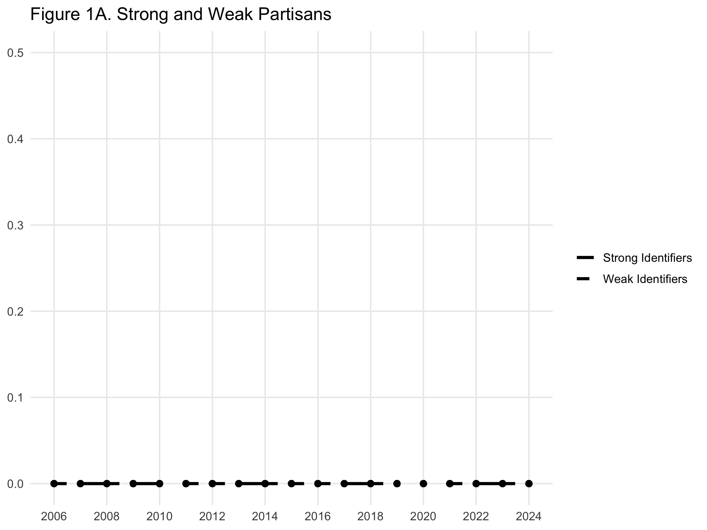
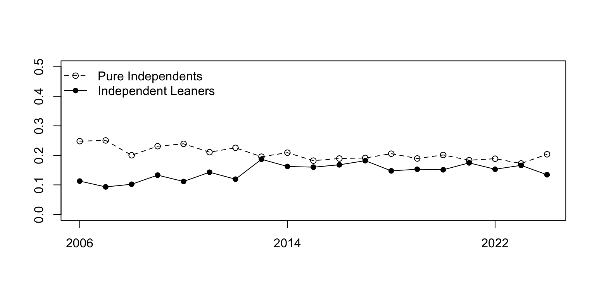
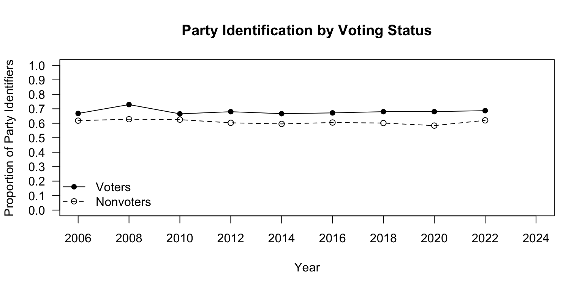

What follows are two replications of Bartel's Figures 1 and 2 from "Partisanship and Voting Behavior" (2000), using the Cumulative CCES Dataset:

- Figure 1: The Distribution of Party Identification
- Figure 2: Party Identification Among Presidential Voters and Nonvoters

## Figure 1A
{fig-align="center" width="70%"}

## Figure 1B
{fig-align="center" width="70%"}

## Figure 2
{fig-align="center" width="70%"}

1. One challenge I encountered during this practicum was recoding the party identification and voter turnout variables to match the categories used in Bartels (2000). I had to make sure that respondents were correctly classified as strong partisans, weak partisans, leaners, or pure independents, while excluding non-substantive responses. I also had to account for missing data when calculating yearly proportions and distinguish between voters and nonvoters.

2. A significant difference I encountered when replicating Bartels (2000) using the cumulative CCES dataset, rather than the ANES, was that the figures could differ in the distribution of party identification and the relationship between partisanship and voter turnout. The CCES data covers elections from 2006 to 2024, whereas Bartels used an earlier period of ANES data. Differences in survey questions, variable coding, and the time periods covered may help explain these variations. In particular, changes in the political environment over time may have affected the proportions of strong partisans, weak partisans, and independents, as well as the differences in party identification between voters and nonvoters.